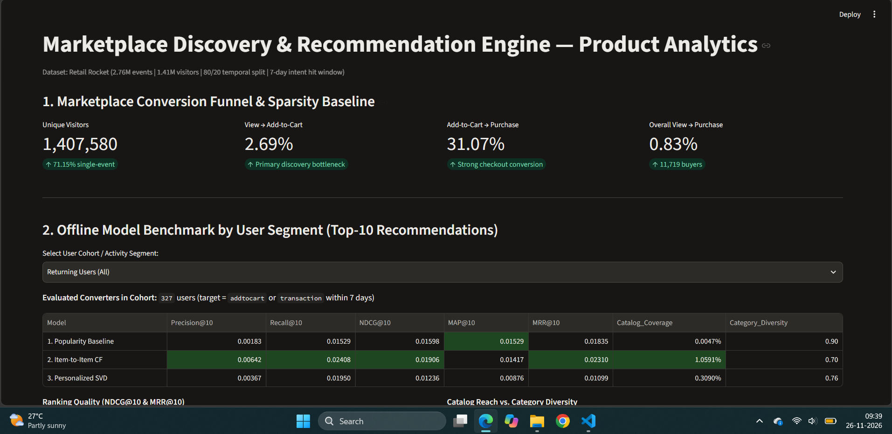
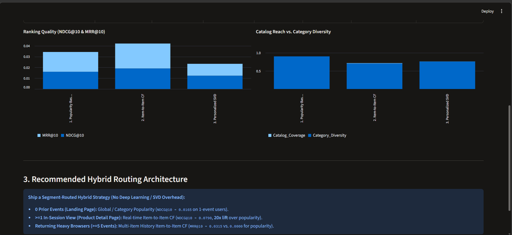

# Marketplace Discovery & Recommendation Engine — Product Analytics Case Study





An end-to-end **Product Analytics & Machine Learning Evaluation** case study diagnosing top-of-funnel discovery friction on **2.76M e-commerce clickstream events** (Retail Rocket) and designing a segment-routed recommendation strategy backed by a sized A/B experiment.

---

## 1. Executive Summary & Funnel Diagnosis
* **Scale Audited:** `2,756,101` events across `1,407,580` unique visitors and `235,061` catalog items over 4.5 months.
* **Primary Bottleneck:** While checkout intent is healthy (**`31.07%` Add-to-Cart $\rightarrow$ Purchase**), top-of-funnel discovery converts at only **`2.69%` View $\rightarrow$ Add-to-Cart** (`0.83%` overall View $\rightarrow$ Purchase).
* **Extreme Sparsity:** **`71.15%`** of all visitors record only **1 event**, and **`89.26%`** of test-period converters are first-time visitors unseen during training.
* **Key Recommendation (Derived from Offline Benchmark Results):** Rather than shipping a single complex model, offline segment analysis supports testing a **Segment-Routed Hybrid Strategy**—serving lightweight popularity on zero-history landings and switching to real-time Item-to-Item Collaborative Filtering once a user records $\ge 1$ in-session view (delivering a **20.2x NDCG@10 lift** on cold-start browsers in offline simulation). *(Note: This hybrid routing rule is an analytical recommendation derived from benchmark trade-offs and requires online A/B validation before full rollout.)*

---

## 2. Evaluation Methodology & Exact Metric Definitions
To prevent data leakage, events are partitioned using a strict **80/20 chronological split**, with ground-truth relevance defined as any `addtocart` or `transaction` event within a **7-day forward intent window** immediately following the split cutoff.

All ranking metrics are evaluated at **$K = 10$** and averaged across **$U_{\text{eval}}$**, the set of eligible cohort users with $\ge 1$ ground-truth positive interaction in the 7-day test window:

* **$\text{Precision}@10$:** $\frac{1}{|U_{\text{eval}}|} \sum_{u \in U_{\text{eval}}} \frac{|R_u(10) \cap G_u|}{10}$, where $R_u(10)$ is the top-10 recommended list and $G_u$ is user $u$'s ground-truth intent set.
* **$\text{Recall}@10$:** $\frac{1}{|U_{\text{eval}}|} \sum_{u \in U_{\text{eval}}} \frac{|R_u(10) \cap G_u|}{|G_u|}$.
* **$\text{NDCG}@10$:** Normalized Discounted Cumulative Gain with binary relevance $rel_i \in \{0, 1\}$ at rank $i \in [1, 10]$, normalized by ideal DCG ($\text{IDCG}@10 = \sum_{i=1}^{\min(10, |G_u|)} \frac{1}{\log_2(i+1)}$).
* **$\text{MAP}@10$:** Mean Average Precision at cutoff $10$, computed as $\frac{1}{\min(10, |G_u|)} \sum_{k=1}^{10} P_u(k) \cdot rel_u(k)$ averaged over $U_{\text{eval}}$.
* **$\text{MRR}@10$:** Mean Reciprocal Rank $\frac{1}{|U_{\text{eval}}|} \sum_{u \in U_{\text{eval}}} \frac{1}{\text{rank}_u}$ of the first relevant item in $R_u(10)$ ($0$ if none appears in top 10).
* **$\text{Catalog Coverage}$:** $\frac{\left|\bigcup_{u \in U_{\text{eval}}} R_u(10)\right|}{|I_{\text{active}}|}$, the percentage of active training-catalog items surfaced across all evaluated users.
* **$\text{Category Diversity}$:** Mean fraction of distinct item categories represented within each user's top-10 list ($\frac{|\text{Categories}(R_u(10))|}{10}$).

---

## 3. Segmented Offline Benchmark Results ($K = 10$)

| User Segment | Model | Precision@10 | Recall@10 | NDCG@10 | MAP@10 | MRR@10 | Catalog Coverage | Category Diversity |
| :--- | :--- | :---: | :---: | :---: | :---: | :---: | :---: | :---: |
| **Returning Users (All)** (`n = 327`) | Popularity Baseline | 0.00183 | 0.01529 | 0.01598 | **0.01529** | 0.01835 | 0.0047% | **0.90** |
| **Returning Users (All)** (`n = 327`) | **Item-to-Item CF** | **0.00642** | **0.02408** | **0.01906** | 0.01417 | **0.02310** | **1.0591%** | 0.70 |
| **Returning Users (All)** (`n = 327`) | Personalized SVD | 0.00367 | 0.01950 | 0.01236 | 0.00876 | 0.01099 | 0.3090% | 0.76 |
| **1-Event Cold-Start** (`n = 73`) | **Popularity Baseline** | **0.00411** | **0.03653** | **0.04462** | **0.04462** | **0.05479** | 0.0043% | **0.90** |
| **1-Event Cold-Start** (`n = 73`) | Item-to-Item CF | 0.00274 | 0.01370 | 0.01850 | 0.01850 | 0.02055 | **0.2825%** | 0.69 |
| **Heavy Browsers ($\ge 5$ events)** (`n = 159`) | Popularity Baseline | 0.00000 | 0.00000 | 0.00000 | 0.00000 | 0.00000 | 0.0043% | **0.90** |
| **Heavy Browsers ($\ge 5$ events)** (`n = 159`) | **Item-to-Item CF** | **0.00881** | **0.02736** | **0.02397** | **0.01593** | **0.03152** | **0.6596%** | 0.70 |
| **New Users (0 Train Events)** (`n = 2,718`) | Global Popularity | 0.00066 | 0.00370 | 0.00391 | 0.00372 | 0.00435 | 0.0043% | **0.90** |
| **New Users (0 Train Events)** (`n = 2,718`) | **1st-View Item-to-Item CF** | **0.01696** | **0.07257** | **0.07904** | **0.07368** | **0.09283** | **5.1400%** | 0.69 |

---

## 4. Repository Structure
* `notebooks/01_eda_and_funnel.ipynb` — Clickstream schema audit, funnel conversion diagnosis, and visitor sparsity analysis.
* `notebooks/02_model_benchmark_and_segments.ipynb` — Temporal train/test split, model training, and cohort-segmented evaluation.
* `src/data_prep.py` — Timestamp parsing, chronological splitting, and 7-day forward ground-truth construction.
* `src/models.py` — Popularity baseline, cosine Item-to-Item Collaborative Filtering, and TruncatedSVD latent factor models.
* `src/metrics.py` — Vectorized Precision@K, Recall@K, NDCG@K, MAP@K, MRR@K, Catalog Coverage, and Category Diversity evaluators.
* `app.py` — Interactive Streamlit product analytics dashboard for exploring segment trade-offs.
* `reports/product_decision_memo.md` — Executive product decision memo with a sized 6-week A/B experiment (~196K visitors/variant, 80% power, $\alpha = 0.05$, 10% relative MDE) and guardrail metrics.

---

## 5. Setup & Local Execution
1. **Clone the repository:**
   ```bash
   git clone [https://github.com/Pujitha-Gedela/marketplace-discovery-recs.git](https://github.com/Pujitha-Gedela/marketplace-discovery-recs.git)
   cd marketplace-discovery-recs